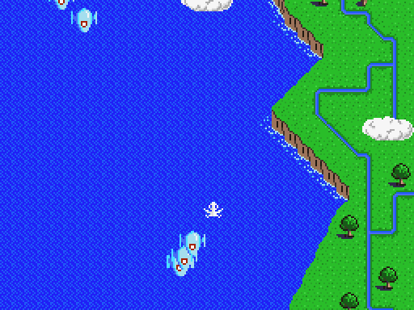
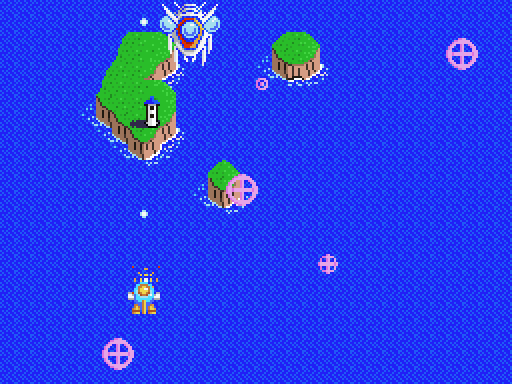
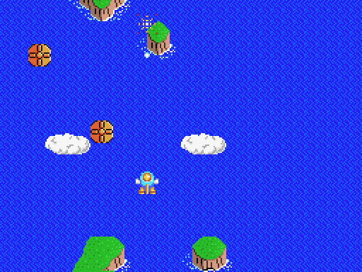

[Español](README.md) · **English** · [日本語](README.ja.md)

# Twin Bee V9990 (GFX9000)

A conversion of MSX **Twin Bee** (Konami, 1986, RC-740) to the **GFX9000 / V9990**, with new graphics by **GUANTXIP**. The game is shown on the V9990 (P1 mode, 256x212, two background layers and 16-colour sprites), and the MSX screen shows the game status.

There are two versions, and both are distributed **as IPS patches only**: the game belongs to Konami, and no ROM or file of the original is published here.

| Version | Patch | ROM it applies to | Result |
| --- | --- | --- | --- |
| **SCC** (SCC music) | `releases/TwinBee_V9990_SCC.ips` | "Twin Bee SCC Enhanced" hack, 128 KB<br>SHA1 `d6c2fb595fed9964d96eb7b355776ecf37a762af` | 256 KB MegaROM, **Konami SCC** mapper<br>SHA1 `eae738a597f519a7835d1b3ccb24af6f517d3d6f` |
| **PSG** (original music) | `releases/TwinBee_V9990_PSG.ips` | Original Twin Bee (RC-740), 32 KB<br>SHA1 `d33fe18ede20da4dd3d6991a9c2995e149c8fc3f` | 256 KB MegaROM, **Konami** mapper (no SCC)<br>SHA1 `31204b0ce0b4d7e8375b7b4bf7def90eb0fd6a0a` |

`releases/` also has test patches with **infinite lives** (`*_vidas_infinitas.ips`), applied to the same ROMs:
- SCC with infinite lives: SHA1 `df2f2bacc04f80ecf3ce10f94ec4057dafaec759`.
- PSG with infinite lives: SHA1 `45ac0fb4cda11637518ebf345eee62584dbcbfd4`.

  

## Applying the patch

1. Check the SHA1 of your ROM (table above). With any other ROM the result will not work.
2. Apply the `.ips` with any IPS patcher: [Flips](https://github.com/Alcaro/Flips), Lunar IPS, [RomPatcher.js](https://www.marcrobledo.com/RomPatcher.js/)… The patch grows the ROM to 256 KB.
3. The repository script works too: `python3 src/make_ips.py --apply your_rom.rom releases/TwinBee_V9990_SCC.ips twinbee_v9990_scc.rom`.

## Playing

- **Requirements:** any MSX (MSX1, MSX2 or MSX2+) with 16 KB of RAM or more, and a **GFX9000** (V9990) on ports 60h-6Fh.
- **Without a GFX9000** both ROMs play like the normal game.
- **Flash carts and other emulators:** choose the "Konami SCC" mapper for the SCC version and "Konami" (without SCC) for the PSG one.
- **openMSX:**
  - SCC: `openmsx -ext gfx9000 -cart twinbee_v9990_scc.rom`
  - PSG: `openmsx -ext gfx9000 -cart twinbee_v9990_psg.rom -romtype Konami`
  - Then, in the console: `set videosource GFX9000`.
- At power-on, loading the graphics into the V9990 takes about 2 s with a black screen.

## What the V9990 shows

| Part of the game | How it is shown |
| --- | --- |
| Background of the 5 stages | Two layers with GUANTXIP's art, smooth scrolling in sync with the game's. |
| Sprites | Each MSX sprite is replaced by its 16-colour drawing (two-palette bosses use two sprites). No flicker. Enemy bullets are drawn in front of everything. |
| Bells | Every colour has its own drawing, including the black bell. |
| Bosses | Fought over the end of their stage's map; when one is beaten the background does not change a single pixel. |
| Ground objects | Drawn as sprites that move with the background. |
| Height | All 212 lines are used: the map reaches the bottom and the ship can fly down to the edge. |
| Logo, title, game over and ending | The original screen converted to the V9990. |
| Hidden credits | New line **COLOR GUANTXIP**. |
| MSX screen | During play it shows stage, high score, scores and lives. |

## Performance

Measured in openMSX over a full playthrough (5 stages and 5 bosses, same key presses), in game-logic frames per second:

| Version | Logic fps |
| --- | --- |
| Original Twin Bee (PSG) | 30.0 (its maximum) |
| **Twin Bee V9990 PSG** | **30.0** |
| Twin Bee SCC Enhanced without GFX9000 | 25.3 |
| **Twin Bee V9990 SCC** | **28.6** |

The SCC version runs faster than the SCC hack itself because the output stage of its music player was rewritten (from 3.1 ms to 2.0 ms per frame, with exactly the same PSG and SCC writes).

## What is in the repository

- `releases/`: the IPS patches.
- `src/`: graphics converter and V9990 driver, in Python and Z80 assembly ([sjasmplus](https://github.com/z00m128/sjasmplus)).
- `art/`: the GUANTXIP graphics used by the converter.
- `docs/`: changes and technical details ([español](docs/CAMBIOS.md), [English](docs/CHANGES.en.md), [日本語](docs/CHANGES.ja.md)) and screenshots.

**No ROMs or files of the original game are included**, nor any dumps of its memory.

## Building

You need Python 3 with `numpy` and `Pillow`, and sjasmplus. You also need some files from the original, which you must take from your own copy:

- `src/twinbee_scc_base.rom`: the SCC Enhanced ROM (SHA1 `d6c2fb59…`), for the SCC version.
- `src/twinbee_orig_base.rom`: the original ROM (SHA1 `d33fe18e…`), for the PSG version.
- `src/ref/`: dumps of the 16 KB of TMS9918 VRAM of the original game (in openMSX: `debug read_block VRAM 0 0x4000`). The sprite patterns, the font and the screens without new art are taken from them. They are `logoB.vram` (Konami logo), `title.vram` (title), `stage0.vram` … `stage4.vram` (at the start of each of the 5 stages) and `ending.vram` (ending).

```sh
cd src
SJASMPLUS=/path/to/sjasmplus python3 mkrom_scc.py   # -> ../twinbee_v9990_scc.rom
SJASMPLUS=/path/to/sjasmplus python3 mkrom_orig.py  # -> ../twinbee_v9990_psg.rom
```

- `TB_INFINITE=1` builds the infinite-lives versions.
- With the input files listed in `src/inputs.sha1` (the ones used here), the ROMs come out byte-identical to the patched ones. `ref/` dumps taken at other moments may give small differences.
- `python3 make_ips.py base.rom new.rom patch.ips` makes a patch and checks that it reproduces the ROM.

## Credits

- Original game: Konami, 1986.
- "Twin Bee SCC Enhanced" version (base of the SCC version; not included): its authors.
- V9990 graphics: GUANTXIP.
- Direction and testing: araubi.
- Beta testers: DTensoMSX, Roberto Álvarez and Xavi Sorinas.
- Code, tools and documentation: developed with Claude (Anthropic).

## License and notices

- **Code and tools** (`src/`): [MIT](LICENSE).
- **Graphics and documentation** (`art/`, `docs/` and the READMEs): [CC BY-NC-SA 4.0](LICENSE-ART).
- **Original game and the patches in `releases/`:** *Twin Bee* (ツインビー) is a work of Konami (1986), and its characters, designs, code and trademarks belong to their owners. The patches in `releases/` modify the original game and are not covered by either licence above. This conversion is a non-profit tribute: no rights over the original are claimed, and the files will be removed if the rights holders ask.
