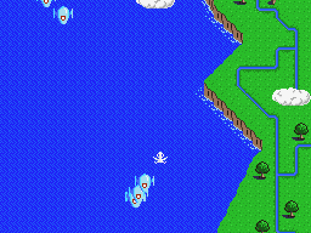
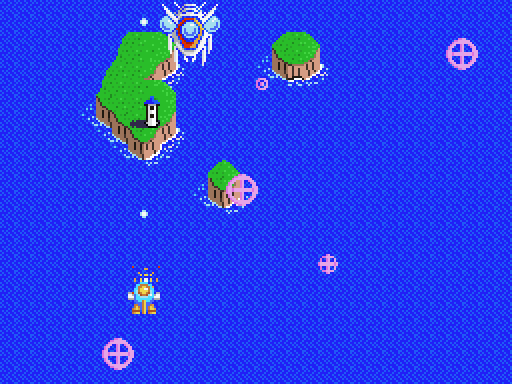
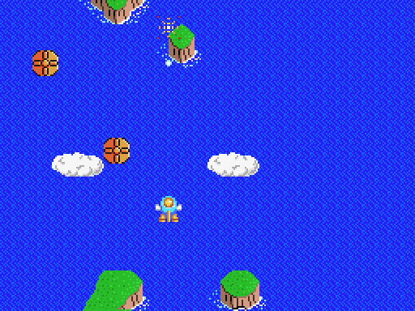

[Español](README.md) · [English](README.en.md) · **日本語**

# ツインビー V9990（GFX9000）

MSX版 **ツインビー**（コナミ、1986年、RC-740）を **GFX9000 / V9990** に移植したものです。グラフィックは **GUANTXIP** による新規描き起こしです。ゲーム画面は V9990（P1モード、256x212、背景2レイヤー、16色スプライト）に表示され、MSX側の画面にはゲームの状況が表示されます。

2つのバージョンがあり、どちらも **IPSパッチのみ** で配布しています。ゲームの権利はコナミにあるため、ここではROMやオリジナルのファイルは一切公開していません。

| バージョン | パッチ | 適用するROM | 結果 |
| --- | --- | --- | --- |
| **SCC**（SCC音源） | `releases/TwinBee_V9990_SCC.ips` | 改造版「Twin Bee SCC Enhanced」128KB<br>SHA1 `d6c2fb595fed9964d96eb7b355776ecf37a762af` | 256KB メガROM、**Konami SCC** マッパー<br>SHA1 `eae738a597f519a7835d1b3ccb24af6f517d3d6f` |
| **PSG**（オリジナルの音楽） | `releases/TwinBee_V9990_PSG.ips` | オリジナル版ツインビー（RC-740）32KB<br>SHA1 `d33fe18ede20da4dd3d6991a9c2995e149c8fc3f` | 256KB メガROM、**Konami** マッパー（SCCなし）<br>SHA1 `31204b0ce0b4d7e8375b7b4bf7def90eb0fd6a0a` |

`releases/` には、同じROMに適用する **残機無限** のテスト用パッチ（`*_vidas_infinitas.ips`）もあります。
- SCC・残機無限：SHA1 `df2f2bacc04f80ecf3ce10f94ec4057dafaec759`
- PSG・残機無限：SHA1 `45ac0fb4cda11637518ebf345eee62584dbcbfd4`

  

## パッチの当て方

1. お手持ちのROMのSHA1を確認してください（上の表）。違うROMでは正しく動きません。
2. 任意のIPSパッチャーで `.ips` を適用します：[Flips](https://github.com/Alcaro/Flips)、Lunar IPS、[RomPatcher.js](https://www.marcrobledo.com/RomPatcher.js/) など。パッチによりROMは256KBに拡張されます。
3. リポジトリのスクリプトも使えます：`python3 src/make_ips.py --apply your_rom.rom releases/TwinBee_V9990_SCC.ips twinbee_v9990_scc.rom`

## 遊び方

- **動作環境：** RAM 16KB以上のMSX（MSX1、MSX2、MSX2+）と、I/Oポート 60h-6Fh の **GFX9000**（V9990）。
- **GFX9000がない場合**、どちらのROMも通常のゲームとして動作します。
- **フラッシュカートリッジや他のエミュレータ：** SCC版は「Konami SCC」、PSG版は「Konami」（SCCなし）マッパーを選んでください。
- **openMSX：**
  - SCC：`openmsx -ext gfx9000 -cart twinbee_v9990_scc.rom`
  - PSG：`openmsx -ext gfx9000 -cart twinbee_v9990_psg.rom -romtype Konami`
  - その後、コンソールで `set videosource GFX9000`
- 起動時、V9990へのグラフィック読み込みに約2秒かかります（その間、画面は黒のままです）。

## V9990での表示内容

| ゲームの部分 | 表示方法 |
| --- | --- |
| 5ステージの背景 | GUANTXIPのアートによる2レイヤー。ゲームと同期したなめらかなスクロール。 |
| スプライト | MSXの各スプライトを16色の絵に置き換え（2パレットのボスは2枚のスプライトで構成）。ちらつきなし。敵弾は最前面に表示。 |
| ベル | 黒いベルも含め、色ごとに専用の絵。 |
| ボス | 各ステージのマップの最後で戦闘。倒しても背景は1ドットも変わりません。 |
| 地上物 | 背景と一緒に動くスプライトとして描画。 |
| 縦の表示範囲 | 212ライン全てを使用。マップは画面下端まで表示され、自機も下端まで移動できます。 |
| ロゴ、タイトル、ゲームオーバー、エンディング | オリジナルの画面をV9990用に変換。 |
| 隠しクレジット | 新しい行 **COLOR GUANTXIP** を追加。 |
| MSX側の画面 | プレイ中はステージ、ハイスコア、スコア、残機を表示。 |

## 処理速度

openMSXで、同じキー入力による全編プレイ（5ステージ・5ボス）を計測した、ゲームロジックの毎秒フレーム数：

| バージョン | ロジックfps |
| --- | --- |
| オリジナル版ツインビー（PSG） | 30.0（上限） |
| **ツインビー V9990 PSG** | **30.0** |
| Twin Bee SCC Enhanced（GFX9000なし） | 25.3 |
| **ツインビー V9990 SCC** | **28.6** |

SCC版は、音楽プレーヤーの出力部分を書き直したため（1フレームあたり3.1msから2.0msへ。PSGとSCCへの書き込み内容はまったく同じ）、元のSCC改造版よりも高速です。

## リポジトリの内容

- `releases/`：IPSパッチ。
- `src/`：グラフィック変換ツールとV9990ドライバ。PythonとZ80アセンブリ（[sjasmplus](https://github.com/z00m128/sjasmplus)）。
- `art/`：変換ツールが使用するGUANTXIPのグラフィック。
- `docs/`：変更点と技術的な詳細（[español](docs/CAMBIOS.md)、[English](docs/CHANGES.en.md)、[日本語](docs/CHANGES.ja.md)）とスクリーンショット。

**ROMやオリジナルゲームのファイル、そのメモリのダンプは含まれていません。**

## ビルド方法

`numpy` と `Pillow` を入れたPython 3、およびsjasmplusが必要です。さらに、各自のオリジナルから用意する次のファイルが必要です。

- `src/twinbee_scc_base.rom`：SCC Enhanced版ROM（SHA1 `d6c2fb59…`）。SCC版用。
- `src/twinbee_orig_base.rom`：オリジナルROM（SHA1 `d33fe18e…`）。PSG版用。
- `src/ref/`：オリジナルゲームのTMS9918 VRAM 16KBのダンプ（openMSXでは `debug read_block VRAM 0 0x4000`）。スプライトのパターン、フォント、新しいアートのない画面をここから取り出します。ファイルは `logoB.vram`（コナミロゴ）、`title.vram`（タイトル）、`stage0.vram` … `stage4.vram`（5つの各ステージ開始時）、`ending.vram`（エンディング）です。

```sh
cd src
SJASMPLUS=/path/to/sjasmplus python3 mkrom_scc.py   # -> ../twinbee_v9990_scc.rom
SJASMPLUS=/path/to/sjasmplus python3 mkrom_orig.py  # -> ../twinbee_v9990_psg.rom
```

- `TB_INFINITE=1` で残機無限版をビルドします。
- `src/inputs.sha1` に記載の入力ファイル（ここで使ったもの）を使えば、パッチ適用後と1バイトも違わないROMが得られます。別のタイミングで取った `ref/` のダンプでは、わずかな差が出ることがあります。
- `python3 make_ips.py base.rom new.rom patch.ips` でパッチを作成し、ROMが再現できるか確認します。

## クレジット

- オリジナルゲーム：コナミ、1986年
- 「Twin Bee SCC Enhanced」版（SCC版のベース。同梱していません）：その作者の方々
- V9990用グラフィック：GUANTXIP
- ディレクション・テスト：araubi
- ベータテスター：DTensoMSX、Roberto Álvarez、Xavi Sorinas
- コード、ツール、ドキュメント：Claude（Anthropic）を用いて開発

## ライセンスと注意事項

- **コードとツール**（`src/`）：[MIT](LICENSE)
- **グラフィックとドキュメント**（`art/`、`docs/`、各README）：[CC BY-NC-SA 4.0](LICENSE-ART)
- **オリジナルゲームと `releases/` のパッチ：** 『ツインビー』はコナミ（1986年）の作品であり、そのキャラクター、デザイン、プログラム、商標は各権利者に帰属します。`releases/` のパッチはオリジナルゲームを改変するものであり、上記のいずれのライセンスの対象にもなりません。本移植は非営利のオマージュです。オリジナルに対するいかなる権利も主張せず、権利者からの要請があればファイルを削除します。
