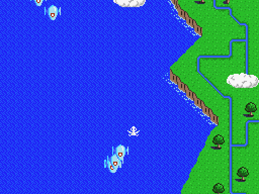
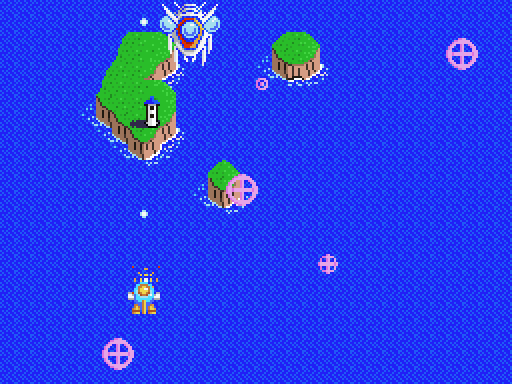
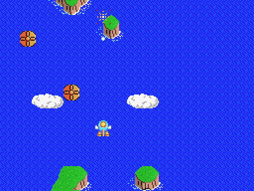

**Español** · [English](README.en.md) · [日本語](README.ja.md)

# Twin Bee V9990 (GFX9000)

Conversión del **Twin Bee** de MSX (Konami, 1986, RC-740) a la **GFX9000 / V9990**, con gráficos nuevos de **GUANTXIP**. El juego se ve en la V9990 (modo P1, 256x212, dos capas de fondo y sprites de 16 colores) y la pantalla del MSX muestra la información de la partida.

Hay dos versiones, y las dos se distribuyen **solo como parches IPS**: el juego es de Konami y aquí no se publica ninguna ROM ni ningún fichero del original.

| Versión | Parche | ROM a la que se aplica | Resultado |
| --- | --- | --- | --- |
| **SCC** (música SCC) | `releases/TwinBee_V9990_SCC.ips` | Hack "Twin Bee SCC Enhanced", 128 KB<br>SHA1 `d6c2fb595fed9964d96eb7b355776ecf37a762af` | MegaROM 256 KB, mapper **Konami SCC**<br>SHA1 `eae738a597f519a7835d1b3ccb24af6f517d3d6f` |
| **PSG** (música original) | `releases/TwinBee_V9990_PSG.ips` | Twin Bee original (RC-740), 32 KB<br>SHA1 `d33fe18ede20da4dd3d6991a9c2995e149c8fc3f` | MegaROM 256 KB, mapper **Konami** (sin SCC)<br>SHA1 `31204b0ce0b4d7e8375b7b4bf7def90eb0fd6a0a` |

En `releases/` hay también parches de pruebas con **vidas infinitas** (`*_vidas_infinitas.ips`), que se aplican a las mismas ROMs:
- SCC con vidas infinitas: SHA1 `df2f2bacc04f80ecf3ce10f94ec4057dafaec759`.
- PSG con vidas infinitas: SHA1 `45ac0fb4cda11637518ebf345eee62584dbcbfd4`.

  

## Cómo aplicar el parche

1. Comprueba el SHA1 de tu ROM (tabla de arriba). Con otra ROM el resultado no funcionará.
2. Aplica el `.ips` con cualquier parcheador IPS: [Flips](https://github.com/Alcaro/Flips), Lunar IPS, [RomPatcher.js](https://www.marcrobledo.com/RomPatcher.js/)… El parche hace crecer la ROM hasta 256 KB.
3. También vale el script del repositorio: `python3 src/make_ips.py --apply tu_rom.rom releases/TwinBee_V9990_SCC.ips twinbee_v9990_scc.rom`.

## Cómo jugar

- **Requisitos:** cualquier MSX (MSX1, MSX2 o MSX2+) con 16 KB de RAM o más y una **GFX9000** (V9990) en los puertos 60h-6Fh.
- **Sin GFX9000** las dos ROMs funcionan como el juego normal.
- **Flashcarts y otros emuladores:** elige el mapper "Konami SCC" para la versión SCC y "Konami" (sin SCC) para la PSG.
- **openMSX:**
  - SCC: `openmsx -ext gfx9000 -cart twinbee_v9990_scc.rom`
  - PSG: `openmsx -ext gfx9000 -cart twinbee_v9990_psg.rom -romtype Konami`
  - Después, en la consola: `set videosource GFX9000`.
- Al encender, la carga de gráficos en la V9990 tarda unos 2 s con la pantalla en negro.

## Qué se ve en la V9990

| Parte del juego | Cómo se muestra |
| --- | --- |
| Fondo de las 5 fases | Dos capas con el arte de GUANTXIP, con scroll suave sincronizado con el del juego. |
| Sprites | Cada sprite del MSX se sustituye por su dibujo de 16 colores (los jefes de dos paletas, con dos sprites). Sin parpadeo. Las balas enemigas quedan delante de todo. |
| Campanas | Cada color tiene su dibujo, también la campana negra. |
| Jefes | Se pelean sobre el final del mapa de su fase; al vencerlos el fondo no cambia ni un píxel. |
| Objetos de tierra | Se dibujan como sprites que se mueven con el fondo. |
| Altura | Se usan las 212 líneas: el mapa llega hasta abajo y la nave puede bajar hasta el borde. |
| Logo, título, fin de partida y final | La pantalla original convertida a la V9990. |
| Créditos ocultos | Línea nueva **COLOR GUANTXIP**. |
| Pantalla del MSX | Mientras se juega muestra fase, récord, puntuaciones y vidas. |

## Rendimiento

Medido en openMSX en una partida completa (5 fases y 5 jefes, con las mismas teclas), en cuadros de lógica por segundo:

| Versión | Fps de lógica |
| --- | --- |
| Twin Bee original (PSG) | 30,0 (su tope) |
| **Twin Bee V9990 PSG** | **30,0** |
| Twin Bee SCC Enhanced sin GFX9000 | 25,3 |
| **Twin Bee V9990 SCC** | **28,6** |

La versión SCC va más rápida que el propio hack SCC porque se ha reescrito la salida de su reproductor de música (de 3,1 ms a 2,0 ms por cuadro, con las mismas escrituras al PSG y al SCC).

## Qué hay en el repositorio

- `releases/`: los parches IPS.
- `src/`: conversor de gráficos y driver V9990, en Python y ensamblador Z80 ([sjasmplus](https://github.com/z00m128/sjasmplus)).
- `art/`: los gráficos de GUANTXIP que usa el conversor.
- `docs/`: los cambios y detalles técnicos ([español](docs/CAMBIOS.md), [English](docs/CHANGES.en.md), [日本語](docs/CHANGES.ja.md)) y capturas.

**No se incluyen ROMs ni ficheros del juego original**, ni volcados de su memoria.

## Cómo recompilar

Hace falta Python 3 con `numpy` y `Pillow`, y sjasmplus. También hacen falta ficheros del original, que cada uno debe sacar de su copia:

- `src/twinbee_scc_base.rom`: la ROM SCC Enhanced (SHA1 `d6c2fb59…`), para la versión SCC.
- `src/twinbee_orig_base.rom`: la ROM original (SHA1 `d33fe18e…`), para la versión PSG.
- `src/ref/`: volcados de los 16 KB de VRAM del TMS9918 del juego original (en openMSX: `debug read_block VRAM 0 0x4000`). De ellos se sacan los patrones de los sprites, la fuente y las pantallas que no tienen arte nuevo. Son `logoB.vram` (logo de Konami), `title.vram` (título), `stage0.vram` … `stage4.vram` (al empezar cada una de las 5 fases) y `ending.vram` (final).

```sh
cd src
SJASMPLUS=/ruta/a/sjasmplus python3 mkrom_scc.py   # -> ../twinbee_v9990_scc.rom
SJASMPLUS=/ruta/a/sjasmplus python3 mkrom_orig.py  # -> ../twinbee_v9990_psg.rom
```

- Con `TB_INFINITE=1` se generan las versiones de vidas infinitas.
- Con los ficheros de entrada de `src/inputs.sha1` (los usados aquí), las ROMs salen idénticas byte a byte a las de los parches. Volcados de `ref/` hechos en otro momento pueden dar pequeñas diferencias.
- `python3 make_ips.py base.rom nueva.rom parche.ips` genera un parche y comprueba que reproduce la ROM.

## Créditos

- Juego original: Konami, 1986.
- Versión "Twin Bee SCC Enhanced" (base de la versión SCC; no se incluye): sus autores.
- Gráficos V9990: GUANTXIP.
- Dirección y pruebas: araubi.
- Beta-testers: DTensoMSX, Roberto Álvarez y Xavi Sorinas.
- Código, herramientas y documentación: desarrollados con Claude (Anthropic).

## Licencia y avisos

- **Código y herramientas** (`src/`): [MIT](LICENSE).
- **Gráficos y documentación** (`art/`, `docs/` y los README): [CC BY-NC-SA 4.0](LICENSE-ART).
- **Juego original y parches de `releases/`:** *Twin Bee* (ツインビー) es obra de Konami (1986), y sus personajes, diseños, código y marcas son de sus titulares. Los parches de `releases/` modifican el juego original y no están cubiertos por ninguna de las licencias anteriores. Esta conversión es un homenaje sin ánimo de lucro: no se reclama ningún derecho sobre el original, y los ficheros se retirarán si los titulares lo piden.
